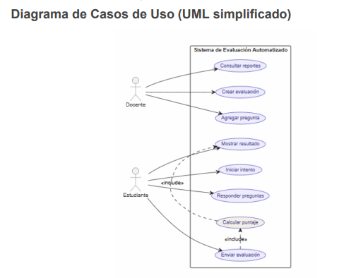

# Informe Técnico: Diseño de un Sistema de Evaluación de Opción Múltiple

---

## 1. Introducción

En el ámbito educativo contemporáneo, la automatización de los procesos de evaluación representa un avance significativo, permitiendo optimizar tanto el tiempo de los docentes como la experiencia de aprendizaje de los estudiantes.

El presente informe técnico tiene como objetivo describir el diseño conceptual de un Sistema de Evaluación Automatizado de Opción Múltiple, orientado a permitir que los estudiantes respondan cuestionarios digitales y obtengan retroalimentación inmediata sobre su desempeño.

Desde una perspectiva de análisis orientado a objetos, se identifican las clases y objetos candidatos, se define un glosario de términos clave, se modelan los casos de uso del sistema y se detallan sus flujos de ejecución.

El sistema contempla dos tipos de usuarios principales: el Docente, responsable de la creación y gestión de evaluaciones, y el Estudiante, quien rinde las pruebas y consulta sus resultados.

---

## 2. Identificación de Clases y Objetos

### Clases principales

#### 2.1. Pregunta

Representa cada consigna presentada al estudiante dentro de una evaluación, almacenando el enunciado, las opciones disponibles, el nivel de dificultad y la respuesta correcta necesaria para el cálculo automático del puntaje.

**Atributos:**

- `id`
- `enunciado`
- `opciones[]`
- `respuestaCorrecta`
- `nivelDificultad`

**Métodos:**

- `obtenerRespuestaCorrecta()`
- `validarRespuesta()`

#### 2.2. Opción

Representa cada alternativa de respuesta asociada a una pregunta, permitiendo al estudiante seleccionar una opción durante la evaluación.

**Atributos:**

- `letra`
- `texto`

**Métodos:**

- `mostrarOpcion()`

#### 2.3. Estudiante

Representa al usuario que realiza evaluaciones dentro del sistema, registrando sus intentos, respuestas y resultados obtenidos.

**Atributos:**

- `id`
- `nombre`
- `apellido`
- `correo`

**Métodos:**

- `iniciarIntento()`
- `responderPregunta()`

#### 2.4. Docente

Representa al usuario responsable de crear, administrar y publicar evaluaciones y preguntas dentro del sistema.

**Atributos:**

- `id`
- `nombre`
- `departamento`

**Métodos:**

- `crearEvaluacion()`
- `agregarPregunta()`

#### 2.5. Evaluación

Representa un conjunto organizado de preguntas configuradas por el docente, incluyendo fechas de disponibilidad, duración y estado de publicación.

**Atributos:**

- `id`
- `titulo`
- `fechaInicio`
- `fechaCierre`
- `duracionMin`
- `estado`

**Métodos:**

- `publicar()`
- `cerrar()`

#### 2.6. Intento

Representa la interacción de un estudiante con una evaluación específica, registrando respuestas, duración y estado del proceso.

**Atributos:**

- `id`
- `fechaHora`
- `duracion`
- `estado`

**Métodos:**

- `finalizar()`
- `calcularDuracion()`

#### 2.7. Respuesta

Representa la opción seleccionada por el estudiante para una pregunta determinada, permitiendo verificar si la respuesta es correcta o incorrecta.

**Atributos:**

- `preguntaId`
- `opcionElegida`
- `esCorrecta`

**Métodos:**

- `verificar()`

#### 2.8. Puntaje

Representa el resultado final obtenido por el estudiante luego de finalizar una evaluación, calculando porcentaje, cantidad de aciertos y estado de aprobación.

**Atributos:**

- `valor`
- `total`
- `porcentaje`
- `aprobado`

**Métodos:**

- `calcular()`
- `determinarAprobacion()`

#### 2.9. Banco de Preguntas (BancoPreguntas)

Representa el repositorio central de preguntas reutilizables utilizado por los docentes para construir evaluaciones. Actúa como clase de soporte interna del sistema; no interactúa directamente con actores externos, sino a través de los casos de uso de gestión del Docente.

**Atributos:**

- `listaPreguntas[]`

**Métodos:**

- `agregarPregunta()`
- `obtenerPreguntas()`

### Relaciones entre clases

- Una Evaluación contiene múltiples Preguntas (1..*).
- Una Pregunta contiene múltiples Opciones (1..*).
- Un Estudiante puede realizar múltiples Intentos (1..*).
- Un Intento genera múltiples Respuestas (1..*).
- Cada Intento tiene un único Puntaje (1..1).
- El Docente gestiona Evaluaciones y el Banco de Preguntas.

---

## 3. Glosario de Términos

**Intento:** ejecución de una evaluación realizada por un estudiante.

**Respuesta correcta:** opción válida definida previamente por el docente.

**Puntaje total:** resultado final obtenido por el estudiante al concluir una evaluación.

**Evaluación activa:** evaluación disponible para ser respondida dentro del período habilitado.

**Retroalimentación:** información brindada al estudiante luego de finalizar la evaluación, indicando aciertos, errores y resultado.

**Banco de preguntas:** repositorio reutilizable de preguntas almacenadas en el sistema, gestionado por el Docente y utilizado como base para construir evaluaciones.

**Pregunta aleatoria:** pregunta seleccionada automáticamente por el sistema sin seguir un orden fijo.

**Evaluación publicada:** evaluación habilitada por el docente para que los estudiantes puedan acceder y responderla.

**Resultado automático:** cálculo inmediato del puntaje realizado por el sistema una vez enviada la evaluación.

**Intento finalizado:** estado alcanzado cuando el estudiante envía la evaluación o cuando se agota el tiempo disponible.

---

## 4. Casos de Uso y Diagrama

### Actores

- **Estudiante:** usuario que accede al sistema para rendir evaluaciones y consultar sus resultados.
- **Docente:** usuario responsable de crear evaluaciones, administrar preguntas y consultar reportes de desempeño.

### Casos de uso principales

- **CU-01:** Crear evaluación
- **CU-02:** Agregar pregunta
- **CU-03:** Iniciar intento
- **CU-04:** Responder preguntas
- **CU-05:** Enviar evaluación
- **CU-06:** Calcular puntaje
- **CU-07:** Mostrar resultado
- **CU-08:** Consultar reportes

### Diagrama de Casos de Uso (UML simplificado)

---

## 5. Fichas de Casos de Uso

### CU-01: Crear evaluación

**Actor:** Docente

**Precondiciones:** El docente debe encontrarse autenticado en el sistema.

**Postcondiciones:** La evaluación queda registrada y disponible para edición.

**Flujo principal:**

1. El docente selecciona la opción "Crear evaluación".
2. Ingresa título, fechas de inicio y cierre, y duración en minutos.
3. Selecciona preguntas del banco de preguntas.
4. El sistema valida la información ingresada.
5. La evaluación queda almacenada con estado "en edición".

**Flujo alternativo:** Si faltan datos obligatorios, el sistema muestra un mensaje de error y no permite guardar la evaluación.

---

### CU-02: Agregar pregunta

**Actor:** Docente

**Precondiciones:** El docente debe encontrarse autenticado en el sistema y debe existir al menos una evaluación creada o en edición.

**Postcondiciones:** La pregunta queda registrada en el sistema y asociada al banco de preguntas, disponible para ser incorporada a evaluaciones.

**Flujo principal:**

1. El docente selecciona la opción "Agregar pregunta".
2. El sistema muestra el formulario de carga de pregunta.
3. El docente ingresa el enunciado de la pregunta.
4. El docente ingresa las opciones de respuesta (mínimo dos, máximo cuatro).
5. El docente indica cuál es la respuesta correcta.
6. El docente selecciona el nivel de dificultad (bajo, medio, alto).
7. El sistema valida que todos los campos obligatorios estén completos.
8. El sistema almacena la pregunta en el banco de preguntas.
9. El sistema muestra un mensaje de confirmación.

**Flujo alternativo:**

- Si el docente no completa el enunciado o no indica la respuesta correcta, el sistema muestra un mensaje de error y no permite guardar la pregunta.
- Si el docente ingresa menos de dos opciones, el sistema solicita completar las alternativas antes de continuar.
- Si el docente cancela la operación, el sistema descarta los datos ingresados y regresa a la pantalla anterior sin guardar cambios.

---

### CU-03: Iniciar intento

**Actor:** Estudiante

**Precondiciones:** La evaluación debe encontrarse activa y el estudiante debe estar autenticado.

**Postcondiciones:** Se crea un nuevo intento asociado al estudiante con fecha y hora de inicio registradas.

**Flujo principal:**

1. El estudiante accede al sistema.
2. Selecciona una evaluación activa.
3. El sistema verifica disponibilidad y tiempo permitido.
4. El sistema crea un nuevo intento.
5. Se registra la fecha y hora de inicio.
6. El sistema muestra la primera pregunta.

**Flujo alternativo:**

- Si la evaluación está cerrada, el sistema muestra un mensaje de acceso denegado.
- Si el estudiante ya alcanzó el máximo de intentos permitidos, el sistema bloquea el acceso.

---

### CU-04: Responder preguntas

**Actor:** Estudiante

**Precondiciones:** El estudiante debe haber iniciado un intento y la evaluación debe encontrarse activa.

**Postcondiciones:** Las respuestas quedan registradas en el sistema asociadas al intento activo.

**Flujo principal:**

1. El sistema muestra la pregunta actual.
2. El estudiante selecciona una opción de respuesta.
3. El sistema registra la respuesta.
4. El estudiante avanza a la siguiente pregunta.
5. El proceso se repite hasta completar todas las preguntas de la evaluación.

**Flujo alternativo:**

- Si el estudiante no selecciona una respuesta e intenta avanzar, el sistema muestra una advertencia.
- Si finaliza el tiempo límite, el sistema envía automáticamente la evaluación con las respuestas registradas hasta ese momento.

---

### CU-05: Enviar evaluación

**Actor:** Estudiante

**Precondiciones:** El intento debe encontrarse activo y debe existir al menos una respuesta registrada.

**Postcondiciones:** La evaluación queda finalizada y el sistema inicia automáticamente el cálculo del puntaje.

**Flujo principal:**

1. El estudiante selecciona "Enviar evaluación".
2. El sistema solicita confirmación del envío.
3. El estudiante confirma.
4. El sistema cierra el intento y registra la hora de finalización.
5. Las respuestas se envían para corrección automática.
6. El sistema ejecuta el caso de uso CU-06: Calcular puntaje.

**Flujo alternativo:** Si el estudiante cancela el envío, el sistema mantiene el intento activo y permite continuar respondiendo.

---

### CU-06: Calcular puntaje

**Actor:** Sistema

**Precondiciones:** La evaluación debe haber sido enviada correctamente y el intento debe estar en estado finalizado.

**Postcondiciones:** El puntaje queda almacenado y disponible para consulta por parte del estudiante.

**Flujo principal:**

1. El sistema recibe las respuestas asociadas al intento finalizado.
2. Se comparan las respuestas seleccionadas con las respuestas correctas definidas por el docente.
3. El sistema calcula la cantidad de aciertos y errores.
4. Se obtiene el porcentaje final sobre el total de preguntas.
5. El sistema determina si el estudiante aprueba según el umbral configurado.
6. El puntaje queda almacenado y se ejecuta el caso de uso CU-07: Mostrar resultado.

**Flujo alternativo:** Si existen preguntas sin responder, el sistema las contabiliza automáticamente como incorrectas.

---

### CU-07: Mostrar resultado

**Actor:** Estudiante

**Precondiciones:** El puntaje debe haber sido calculado y almacenado correctamente.

**Postcondiciones:** El estudiante visualiza el resultado final de su evaluación.

**Flujo principal:**

1. El sistema muestra el puntaje total obtenido.
2. Se visualiza el detalle de respuestas correctas e incorrectas.
3. El sistema indica si el estudiante aprobó o no la evaluación.
4. El estudiante puede cerrar la pantalla de resultados o volver al inicio.

**Flujo alternativo:** Si ocurre un error al cargar los resultados, el sistema muestra un mensaje de reintento.

---

### CU-08: Consultar reportes

**Actor:** Docente

**Precondiciones:** El docente debe encontrarse autenticado en el sistema y debe existir al menos una evaluación con intentos finalizados.

**Postcondiciones:** El docente visualiza el reporte de desempeño de los estudiantes para la evaluación seleccionada.

**Flujo principal:**

1. El docente selecciona la opción "Consultar reportes".
2. El sistema muestra el listado de evaluaciones disponibles.
3. El docente selecciona una evaluación.
4. El sistema muestra un reporte con los resultados: puntajes, porcentajes y estado de aprobación por estudiante.
5. El docente puede filtrar por estudiante o por resultado.

**Flujo alternativo:** Si la evaluación seleccionada no tiene intentos registrados, el sistema muestra un mensaje indicando que aún no hay datos disponibles.

---

## 6. Conclusiones

El diseño de un sistema de evaluación automatizado de opción múltiple es viable mediante la aplicación de principios de análisis orientado a objetos.

La correcta identificación de clases, la definición de términos clave y la modelización de casos de uso permiten estructurar un sistema robusto, claro y funcional. La incorporación de la ficha completa del caso de uso CU-02 y la aclaración del rol interno de la clase BancoPreguntas refuerzan la coherencia entre el modelo de clases y el modelo de comportamiento del sistema.

Este tipo de sistemas aporta eficiencia, objetividad y rapidez en los procesos de evaluación, siendo especialmente relevante en entornos educativos digitales.

El sistema propuesto constituye una solución escalable y adaptable a distintos contextos educativos, pudiendo ampliarse en futuras etapas mediante la incorporación de diagramas de clases UML detallados, diagramas de secuencia, requisitos no funcionales y mejoras en la experiencia de usuario.

---

## 7. Referencias

- Pérez, D. (s.f). Requerimientos y Análisis inicial. Programación 2. Material del curso.
- Pérez, D. (s.f). Casos de uso. Programación 2. Material del curso.
